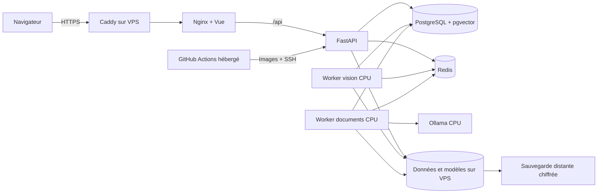

# Héberger toute la plateforme et conserver les modèles — budget cible 10 €/mois

Révision du **29 octobre 2026**. Ce guide remplace la proposition initiale de
calcul sur PC : **après migration, aucune brique, donnée nécessaire, sauvegarde
ou runner ne dépend du PC personnel**. Le PC ne sert qu'au transfert initial et
à l'administration, qui peut ensuite se faire depuis n'importe quelle machine.

La lenteur du CPU est acceptée. Les modèles entraînés doivent être conservés,
avec leur historique et les données nécessaires pour les utiliser. Aucun
réentraînement ou remplacement de modèle n'est requis pour cette migration.

Ce document prépare le déploiement ; il n'achète aucun abonnement, ne transfère
aucune donnée et ne supprime rien sur le PC. Les configurations et workflows
ci-dessous sont des exemples à installer, pas des fichiers déjà actifs.

## 1. Architecture retenue et limites du budget

### Proposition entièrement distante

| Brique | Hébergement |
| --- | --- |
| Vue 3 compilé + Nginx | Conteneur sur le VPS |
| API FastAPI | Conteneur sur le même VPS |
| PostgreSQL 16 + pgvector | Volume persistant sur le VPS |
| Redis avec AOF | Volume persistant sur le VPS |
| Worker vision PyTorch | Image ML CPU sur le VPS, modèles existants |
| Worker documentaire | Conteneur sur le VPS |
| Ollama / génération RAG | CPU sur le VPS, sous réserve de recette mémoire |
| Vidéos, documents, résultats, modèles, checkpoints | Disque persistant du VPS |
| HTTPS | Caddy sur le VPS |
| Nom public | Sous-domaine DuckDNS gratuit |
| Tests, construction des images et CD | GitHub Actions hébergé, déploiement SSH |
| Deuxième copie des données et modèles | Sauvegarde chiffrée chez un autre fournisseur |

Toutes les briques partagent les mêmes chemins internes `/storage/...`, ce qui
préserve le fonctionnement du dépôt sans introduire du stockage distribué.
**Pas de GPU loué en permanence, pas de tunnel vers le domicile, pas de runner
sur le PC, pas de disque personnel nécessaire pour restaurer.**



### Budget cible et devis à vérifier

La page officielle OVHcloud affiche une gamme nommée « VPS 2027 », consultée le
29 octobre 2026 : VPS-2, 4 vCores, 8 Go de RAM et 75 Go NVMe à partir de
7,21 € HT, soit **8,65 € TTC/mois**, avec une sauvegarde quotidienne annoncée.
Ce nom commercial n'est pas une date de migration.
Vérifier disponibilité, région, engagement, renouvellement, IPv4, frais initiaux
et contenu exact de la sauvegarde dans le panier avant achat. Source :
[VPS OVHcloud](https://www.ovhcloud.com/fr/vps/),
[configurateur](https://www.ovhcloud.com/fr/vps/configurator/).

| Poste | Enveloppe mensuelle TTC |
| --- | ---: |
| VPS-2 au prix d'appel vérifié | 8,65 € |
| Sous-domaine gratuit + certificats HTTPS | 0 € |
| GitHub Actions dans l'allocation gratuite + GHCR selon politique actuelle | 0 € |
| Sauvegarde distante chiffrée : **enveloppe cible**, non forfait garanti | 1,00 € |
| **Total visé** | **9,65 €** |
| Marge avant plafond | 0,35 € |

Après le VPS, le budget maximum réellement disponible pour stockage externe,
taxes et éventuels autres frais est **1,35 €/mois**. Une première commande plus
chère ou une option facturée en sus invalide le total ci-dessus.

Backblaze B2 affiche un prix de stockage à partir de 6,95 USD/To/mois : 100 Go
représentent environ 0,695 USD/mois de stockage au prorata, **avant conversion,
taxes et éventuels autres frais**. Ne pas traiter cette valeur comme un prix TTC
en euros. Contrôler région, requêtes, téléchargement, rétention et coût final.
La page annonce une sortie gratuite jusqu'à trois fois le stockage mensuel moyen,
puis une tarification complémentaire. Source :
[tarifs B2](https://www.backblaze.com/cloud-storage/pricing).

Un backup initial de l'ordre de 14 Go hors base laisse une marge de croissance
dans cet exemple, mais plusieurs versions d'un modèle ou de nouvelles vidéos
augmentent le volume facturable. Configurer alertes et suivi ; une alerte n'est
pas un plafond dur. **Le budget n'est pas garanti pour un corpus illimité.**

### Ce que 10 € ne garantissent pas

- Ni les performances de la RTX 3050, ni un temps maximal par vidéo ou dossier.
- Ni l'exécution simultanée de tous les gros modèles dans 8 Go de RAM.
- Ni la reprise fréquente d'entraînements lourds dans des délais raisonnables.
- Ni une conservation illimitée des vidéos, versions de modèles et backups.
- Ni une haute disponibilité : une panne du VPS rend toute la plateforme indisponible.

Le scénario CPU est **un candidat à valider**, pas un benchmark effectué. Si le
modèle réel ou le RAG ne tient pas en mémoire, la lenteur acceptée ne résout pas
un manque de RAM : il faudra adapter explicitement le modèle/la concurrence ou
revoir le budget. Ne pas annoncer une fonctionnalité disponible tant que sa
recette réelle n'est pas passée. Ne pas remplacer un modèle entraîné pour faire
entrer artificiellement le déploiement dans l'enveloppe.

## 2. Conserver les modèles : fichiers ET registre

### Comprendre le workflow avec un exemple

**Ce qu'un réseau a appris est enregistré dans ses poids**, dans les fichiers
de checkpoint. Il n'a pas besoin de continuer à s'entraîner pour conserver cet
apprentissage. Copier un checkpoint intact sur le serveur conserve ses poids.
Le serveur peut ensuite les charger pour analyser de nouvelles vidéos.

Il y a deux besoins différents :

| Besoin | Ce qu'il faut conserver |
| --- | --- |
| Utiliser un modèle déjà entraîné | Poids sélectionnés, architecture, classes, prétraitement et configuration compatibles |
| Continuer un entraînement interrompu | Checkpoint de reprise complet, configuration, mêmes données et manifests compatibles |

Dans le moteur d'entraînement actuel du projet :

- **`best.pt`** contient les poids ayant obtenu le meilleur score de validation,
  avec notamment architecture, classes et prétraitement. Il sert à utiliser et
  évaluer le modèle sélectionné. Ce n'est pas nécessairement la dernière époque.
- **`last.pt`** est la sauvegarde de reprise : poids courants, meilleur état,
  optimiseur, scheduler, scaler, phase, compteur d'époques, historique et états
  aléatoires. C'est ce fichier que le moteur attend pour poursuivre le run.
- **`config.json`**, à côté de ces checkpoints, est relu par la commande de
  reprise. Il doit donc être transféré lui aussi, avec les données référencées.

Cette description correspond aux checkpoints du moteur actuel ; un ancien
fichier `.pt` ou un modèle importé peut avoir un autre contenu. L'extension
seule ne prouve pas qu'il contient un état d'entraînement complet.

Exemple : un entraînement est prévu pour 50 époques. Une époque correspond à
un passage sur les données d'entraînement. La dernière époque sauvegardée est
la 20e et le meilleur score a été obtenu à la 17e.

```text
best.pt : état sélectionné à l'époque 17 → analyser des vidéos
last.pt : état de reprise à l'époque 20 → poursuivre à l'époque 21
```

Le moteur sauvegarde `last.pt` aux frontières d'époques. Si l'arrêt arrive au
milieu de l'époque 21, le travail depuis la dernière sauvegarde peut devoir être
refait. On conserve l'apprentissage sauvegardé ; on ne promet pas une reprise au
mini-batch exact d'une interruption. Le passage GPU → CPU peut aussi modifier
la trajectoire numérique d'un entraînement repris, sans effacer les poids copiés.

### Première mise en ligne : envoyer ce qui existe déjà

1. **Laisser finir ou arrêter proprement l'entraînement** pour obtenir un état
   sauvegardé stable. Ne pas copier un fichier pendant qu'il est réécrit.
2. **Copier les dossiers complets** : `checkpoints/`, `models/`, `results/`,
   les datasets nécessaires et le dump de base. On conserve tous les runs,
   pas seulement le fichier qui semble être le meilleur.
3. **Vérifier les empreintes SHA-256** : si source et destination ont la même
   empreinte, le fichier transféré est identique. Cela vérifie le transfert,
   pas la précision scientifique du modèle.
4. **Charger sur CPU et tester** un modèle connu avec une vidéo connue. Restaurer
   le registre permet de retrouver le champion déjà choisi et son historique.
5. **Sauvegarder sur le second stockage distant**, puis tester sa restauration.
6. **Éteindre le PC et refaire le test**. L'application doit fonctionner sans lui.

Pour cette première migration, il n'y a aucun apprentissage à refaire, aucune
raison de réinitialiser le champion et aucun remplacement automatique des poids.
Le § 5 donne les commandes de transfert et de contrôle.

### Après la migration : entraînement et mise à jour de l'application

Un nouvel entraînement se déroule sur le serveur distant et écrit directement
dans son volume persistant. Il n'y a alors plus d'« envoi depuis le PC » :

```text
Données sur le serveur
    → nouvel entraînement identifié par un nouveau run
    → checkpoints et résultats sur le disque persistant
    → sauvegarde distante
    → évaluation et comparaison avec le champion
    → activation explicite du candidat si sa qualité convient
    → ancien champion conservé pour revenir en arrière
```

Si l'entraînement s'arrête, la reprise se fait avec le `last.pt` de ce run,
sa configuration et ses données. Le moteur vérifie une empreinte de compatibilité
et refuse la reprise si les données, labels ou réglages concernés ont changé.
Ne pas désactiver ce contrôle pour forcer une reprise. Une reprise d'un run
initialement CUDA sur CPU demande aussi d'adapter explicitement le périphérique
de sa configuration : la CLI relit le `config.json` enregistré, donc la variable
d'environnement CPU du serveur ne suffit pas à elle seule. Voir le
[guide d'entraînement](../workers/vision/TRAINING.md).

**La CI/CD de l'application a un autre rôle :** elle met à jour le code et les
conteneurs, en remontant le même dossier de données. Elle ne relance pas un
entraînement, n'écrase pas les checkpoints et ne change pas le modèle actif.
Les opérations sur le modèle passent par évaluation, sauvegarde et activation
explicite. Ce fonctionnement doit être respecté par les scripts de déploiement ;
la documentation ne constitue pas leur installation automatique.

Après un redémarrage, les poids sauvegardés sont toujours sur le disque du VPS.
Après la perte du VPS, on restaure les fichiers **et la base** depuis la sauvegarde
indépendante. Le travail postérieur à la dernière sauvegarde distante peut être
perdu : sauvegarder immédiatement les modèles finalisés et choisir une fréquence
de backup des checkpoints intermédiaires adaptée à la perte acceptable.

### Inventaire constaté dans le dépôt de travail

Mesure des tailles de fichiers le 29 octobre 2026, sans lire le contenu des
secrets et sans charger les modèles :

| Répertoire | Nombre de fichiers | Taille approximative en Gio |
| --- | ---: | ---: |
| `data/models` | 69 | 5,267 |
| `data/checkpoints` | 43 | 3,719 |
| `data/results` | 15 793 | 1,256 |
| `data/documents` | 6 720 | 2,103 |
| `data/datasets` | 410 | 0,598 |
| **Total de ces cinq répertoires** | **23 035** | **12,943** |

Cela représente environ 13,90 Go décimaux. Ce relevé n'inclut **ni les volumes
Docker PostgreSQL/Redis, ni les vidéos sources externes, ni d'autres dossiers
éventuels**, ni l'espace Docker, OS, journaux et fichiers temporaires. Les tailles
changeront avant la migration ; refaire l'inventaire à ce moment-là.

### Périmètre à transférer et sauvegarder

| Élément | Pourquoi le garder |
| --- | --- |
| Tous les checkpoints, y compris `best`, `last` et candidats | Inférence, historique, reprise d'entraînement si l'état le permet |
| `models/` complet | Détecteur, poids préentraînés, encodeurs, modèles Ollama, manifests |
| `results/` complet | Métriques, comparaisons, versions, journaux de campagne, embeddings, manifests et décisions |
| `datasets/` et vérités terrain | Reproductibilité, validation et éventuel réentraînement |
| `documents/` | Corpus, extractions et données associées au RAG |
| Vidéos sources référencées hors `data/` | Éviter des liens vers des fichiers absents après migration |
| Dump PostgreSQL complet | Registre, modèle actif, historique, utilisateurs, sessions et relations |
| Redis ou état de file réconcilié | Éviter de perdre ou rejouer des tâches pendant la bascule |
| Code du commit utilisé, dépendances verrouillées, configurations et classes | Retrouver exactement le format, le prétraitement et l'ordre des labels |

Le registre contient notamment `console_models`, `model_promotions`,
`classifier_comparisons` et les informations d'entraînement. Copier uniquement
le fichier du champion ne conserve pas cet historique. Conserver le dump complet
plutôt qu'une sélection manuelle de tables interdépendantes.

Les checkpoints ne sont pas inclus dans Git ni dans les images Docker actuelles.
Ils doivent rester sur un **volume persistant indépendant des releases**. Le
chemin `DATA_ROOT=/srv/petection/data` sera identique pour tous les déploiements.
Ne pas renommer les fichiers ni changer leurs clés relatives : le registre les
référence et vérifie des empreintes SHA-256.

### Un modèle entraîné sur GPU peut-il tourner sur CPU ?

Le classificateur existant utilise déjà `torch.load(..., map_location="cpu",
weights_only=True)`, puis déplace le modèle vers le périphérique demandé.
MegaDetector accepte `force_cpu`. Le dépôt contient une image ML avec les
dépendances CPU. Il n'est donc pas nécessaire de réentraîner ces modèles pour
**tenter et valider** leur exécution CPU.

Cela ne garantit pas tous les formats et opérateurs de tous les modèles :
tester chaque famille réellement utilisée, l'architecture `timm`, le nombre et
l'ordre des classes, la résolution, le prétraitement et les dépendances. Conserver
les originaux à l'identique, y compris si un export ONNX ou une quantification
est ajouté plus tard. Une version optimisée doit avoir sa propre identité.

La reprise d'entraînement demande aussi l'état optimiseur/scheduler lorsqu'il
est disponible, les seeds, splits et données. Garder `last` en plus de `best`.
Préserver les fichiers ne garantit pas une reprise CUDA identique sur CPU ni une
durée acceptable ; c'est distinct de l'inférence.

## 3. Dimensionner le VPS avant la bascule

Utiliser un VPS **x86-64 Linux**, par exemple Ubuntu 24.04 LTS, et Docker Engine
avec Compose v2. L'image vision à utiliser est la cible `ml` du Dockerfile CPU.
Ne pas ajouter les overrides GPU/Blackwell, ni exiger CUDA.

Le disque annoncé de 75 Go doit accueillir :

```text
OS + paquets
+ images Docker actuelles et précédente release
+ données transférées (~13,90 Go hors volumes à ce jour)
+ PostgreSQL + Redis
+ temporaires, nouvelles vidéos et résultats
+ dump de maintenance et marge d'exploitation
```

Mesurer `df -h`, `docker system df` et la taille des volumes après installation.
Garder une réserve, par exemple 15 Go, plutôt que remplir le disque. Ne pas
construire une grosse image PyTorch sur le VPS de production : les images
seront construites dans GitHub Actions puis téléchargées. Le cache de compilation
et plusieurs générations d'images peuvent dépasser l'espace prévu.

La mémoire mérite une recette séparée : le Compose actuel autorise 6 Go à
Ollama et 2 Go au worker documentaire, auxquels s'ajoutent vision, PostgreSQL,
API et OS. Ces limites ne réservent pas la mémoire et leur somme ne prouve pas
que tout tient dans 8 Go. Deux workers à un replica peuvent travailler en même
temps ; le verrou GPU ne sérialise pas leurs traitements CPU.

Commencer par mesurer séparément :

1. Une analyse vidéo avec les vrais poids, génération RAG au repos.
2. Une recherche documentaire et un dossier RAG, worker vision sans tâche active.
3. La charge concurrente maximale que tu souhaites réellement autoriser.

Relever pic RAM, CPU, durée et éventuel OOM via `docker stats` et les logs du
noyau. En cas de pression mémoire, arrêter temporairement le worker vision pour
une génération documentaire, uniquement après fin de sa tâche en cours, ou
ajouter une vraie admission globale des tâches lourdes. Cette admission n'existe
pas aujourd'hui : ne pas la supposer automatique. Une petite swap peut absorber
un pic mais ne garantit ni la stabilité ni le respect des timeouts.

Conserver initialement le modèle RAG existant. Réduire le contexte ou prendre
un modèle plus petit peut changer la qualité et faire échouer les contrôles de
génération ; ces changements demandent une validation et ne doivent pas être
appliqués silencieusement. Désactiver la génération est un mode de diagnostic,
pas l'achèvement d'un hébergement de toute la fonctionnalité RAG.

## 4. Configuration de production CPU

### Dossiers hors releases

```text
/srv/petection/data/             toutes les données persistantes
/srv/petection/backups/          dumps intermédiaires, pas la seule copie
/srv/petection/releases/<sha>/   code/config Compose d'une release
/srv/petection/state/            SHA déployé, verrou d'exploitation
/etc/petection/production.env    configuration et secrets
/etc/petection/backup.env        accès à la sauvegarde distante
```

Installer Docker selon la [documentation Ubuntu officielle](https://docs.docker.com/engine/install/ubuntu/).
Créer les dossiers et protéger les secrets (`chmod 600`, accès administrateur
uniquement). Les conteneurs applicatifs utilisent l'UID 10001 : tenir compte de
leurs droits de lecture/écriture lors de la restauration des fichiers.

Exemple de `/etc/petection/production.env`, à compléter depuis `.env.example` :

```dotenv
COMPOSE_PROJECT_NAME=biosentinelle
DATA_ROOT=/srv/petection/data
POSTGRES_DB=biosentinelle
POSTGRES_USER=biosentinelle
POSTGRES_PASSWORD=REMPLACER_PAR_UN_SECRET
AUTH_COOKIE_SECURE=true
AUTH_ALLOWED_ORIGINS=https://petection-CHOIX.duckdns.org
BACKEND_PORT=8000
FRONTEND_PORT=8080
VISION_DEVICE=cpu
RAG_GENERATION_ENABLED=true
RAG_GENERATION_DEVICE=cpu
RAG_READING_MODE=balanced
RAG_GENERATOR_URL=http://photosynthese-ollama:11434
RAG_GENERATOR_MODEL=qwen3:4b-instruct-2507-q4_K_M
RAG_GENERATOR_TIMEOUT=600
```

Générer un secret localement, par exemple `openssl rand -hex 32`, sans le publier.
Conserver les noms de base/rôle nécessaires au dump ou préparer leur restauration.
Un changement de `POSTGRES_PASSWORD` dans l'environnement ne modifie pas un rôle
déjà initialisé : synchroniser le mot de passe PostgreSQL explicitement.

### Commande Compose de référence

En Bash, dans la release choisie :

```bash
dc=(docker compose --project-name biosentinelle
    --env-file /etc/petection/production.env
    -f docker-compose.yml -f docker-compose.ml.yml
    --profile rag-generation)
docker network inspect web >/dev/null 2>&1 || docker network create web
"${dc[@]}" config --quiet
```

Le tableau `dc` n'existe que dans ce shell. Le fichier `docker-compose.ml.yml`
active `VISION_CONSUME_JOBS=1` et la cible `ml`, nécessaire pour traiter les tâches.
Le service vision du Compose de base seul n'effectue pas l'inférence ML.
**Ne pas utiliser `docker-compose.gpu.yml` sur ce VPS CPU.**

La mise en place du § 8 ajoute un override d'images construites en CI à cette
commande. Sans cet override, le premier essai peut construire les images avec
`"${dc[@]}" build backend frontend documents vision`, mais ce n'est pas le mode
de déploiement recommandé sur un petit disque de production.

## 5. Migrer les données sans perdre les modèles

### Préparation sur l'installation source

Le nom du projet Compose source peut différer. Adapter toutes les commandes à
l'installation effectivement utilisée et au bon `DATA_ROOT`. Ne pas afficher
la configuration résolue ou le jeton bootstrap dans un log partagé.

1. Noter le commit applicatif, la révision Alembic, les versions PostgreSQL,
   Redis et PyTorch, ainsi que l'identifiant et le SHA du modèle actif.
2. Recenser tous les chemins sources externes, dont les vidéos éventuellement
   importées depuis `video datathon/` ou un autre disque.
3. Bloquer les nouvelles soumissions, laisser finir les tâches, arrêter front,
   backend et workers. Garder PostgreSQL actif pour le dump. Aucun traitement
   d'entraînement ne doit écrire dans un checkpoint pendant sa copie.
4. Exporter la base, produire les manifests, puis transférer les données.

Depuis WSL/Linux à la racine de la source arrêtée, exemple de dump :

```sh
mkdir -p migration
umask 077
docker compose exec -T postgres sh -c \
  'pg_dump -U "$POSTGRES_USER" -d "$POSTGRES_DB" -Fc' \
  > migration/database.dump
test -s migration/database.dump
```

Utiliser Bash/WSL pour cette redirection binaire ; ne pas faire transiter le dump
par un pipeline texte PowerShell. Le dump doit correspondre aux fichiers copiés.
Sauvegarder aussi les réglages et manifests du commit source.

### Manifest d'intégrité des fichiers

Lancer ce petit programme Python depuis le dossier qui contient `data/`. Il ne
charge aucun checkpoint et n'affiche aucun secret ; il calcule les empreintes
des fichiers, y compris les manifests nécessaires au registre :

```python
import hashlib
import json
from pathlib import Path

root = Path("data")
manifest = []
for path in sorted(root.rglob("*")):
    if not path.is_file():
        continue
    digest = hashlib.sha256()
    with path.open("rb") as stream:
        for block in iter(lambda: stream.read(8 * 1024 * 1024), b""):
            digest.update(block)
    manifest.append({
        "path": path.relative_to(root).as_posix(),
        "bytes": path.stat().st_size,
        "sha256": digest.hexdigest(),
    })
Path("data-manifest.json").write_text(
    json.dumps(manifest, ensure_ascii=False, indent=2), encoding="utf-8"
)
```

Vérifier les liens symboliques séparément : un lien pointant hors de `data/`
nécessite le transfert de sa cible et un remappage explicite. Le manifest porte
sur les fichiers ordinaires lus, pas sur la validité métier de leurs références.

Depuis WSL avec `rsync`, exemple de transfert SSH chiffré :

```sh
rsync -rt --partial --info=progress2 data/ deploy@IP_DU_VPS:/srv/petection/data/
rsync -rt migration/ deploy@IP_DU_VPS:/srv/petection/backups/migration/
scp data-manifest.json deploy@IP_DU_VPS:/srv/petection/backups/migration/
```

Créer les dossiers de destination et leurs droits au préalable. Sous Windows,
le projet est accessible depuis WSL via `/mnt/c/...` si nécessaire. Ne pas utiliser
`--delete`, ne pas nettoyer les sources, et conserver les chemins relatifs.
Transférer séparément les vidéos externes recensées ; corriger leurs références
avec les outils du projet plutôt que par des mises à jour SQL improvisées.

### Restaurer sur le VPS, avant de lancer les migrations

Préparer la release du **même commit que la source** et les images correspondantes.
Dans le shell disposant du tableau `dc` :

```bash
"${dc[@]}" up -d --wait postgres redis
"${dc[@]}" run --rm --no-deps storage-init
"${dc[@]}" exec -T postgres sh -c \
  'pg_restore -U "$POSTGRES_USER" -d "$POSTGRES_DB" --no-owner --no-acl --exit-on-error' \
  < /srv/petection/backups/migration/database.dump
```

Cette restauration suppose une **base cible neuve et vide**, pas la base active
d'un autre environnement. La version pgvector doit être compatible. Ne pas
démarrer `backend` avec ses dépendances avant restauration : cela lancerait
`migrate`. Après restauration, vérifier la révision et les erreurs éventuelles,
puis exécuter `"${dc[@]}" run --rm --no-deps migrate` avec le code correspondant.

Ne pas copier le répertoire PostgreSQL brut d'un OS vers un autre. Les volumes
nommés PostgreSQL/Redis sont distincts de `DATA_ROOT` : une copie de `data/` seule
ne conserve pas le registre des modèles.

Redis mérite une décision explicite : après drainage, vérifier l'absence de
tâches métier en attente avant d'utiliser un Redis neuf. Si des tâches ou états
transitoires restent nécessaires, sauvegarder/restaurer Redis avec une procédure
compatible avec sa version et son AOF multipartie, puis réconcilier avec la base.
Ne pas relancer aveuglément des tâches déjà terminées. Garder la sauvegarde source
jusqu'à validation de cette réconciliation.

### Vérification avant ouverture

Relancer le programme de manifest sur le VPS, avec `root = Path("/srv/petection/data")`,
et comparer les listes chemin/taille/SHA-256 à la source. Réparer les droits selon
l'UID 10001, y compris les fichiers copiés : `storage-init` ne réattribue pas
récursivement tous les fichiers existants. Éviter les permissions universelles.

Contrôler dans le registre le nombre de modèles, leurs clés, SHA, classes et
modèle actif. Charger chaque modèle utile sur CPU et analyser une vidéo autorisée
avec le champion conservé. Comparer les sorties aux résultats source avec une
tolérance numérique adaptée : CPU/GPU ne garantissent pas du bit-à-bit identique.

Les fichiers `models/` et `checkpoints/` sont déjà transférés : **ne pas remplacer
les poids par un téléchargement générique** et ne pas lancer un entraînement
pour reconstituer des fichiers que l'on possède. Préparer explicitement uniquement
les dépendances réellement absentes, selon les [guides vision](../workers/vision/INFERENCE.md)
et [RAG](RAG.md).

## 6. HTTPS et nom gratuit

Choisir un sous-domaine disponible sur [DuckDNS](https://www.duckdns.org/), le faire
pointer vers l'IPv4 publique du VPS, puis installer Caddy comme service système.
Ouvrir TCP 80/443 pour le web et SSH pour l'administration ; restreindre SSH
quand possible. Ne pas publier les ports 5432, 6379, 8000, 8080 ou 11434.

Le Compose actuel lie déjà l'API et le frontend à loopback. Caddy tourne ici sur
l'hôte et transmet au frontend Nginx :

```caddyfile
petection-CHOIX.duckdns.org {
    @api path /api /api/*
    header @api Cache-Control "no-store"
    reverse_proxy 127.0.0.1:8080
}
```

Valider avec `sudo caddy validate --config /etc/caddy/Caddyfile`, puis recharger
le service. Laisser Caddy gérer les certificats après configuration correcte du
DNS et de l'accès 80/443. Ne pas enlever `/api` dans Caddy : Nginx le fait déjà.
Voir [installation](https://caddyserver.com/docs/install) et
[HTTPS automatique Caddy](https://caddyserver.com/docs/automatic-https).

Le navigateur garde une seule origine ; les cookies actuels restent compatibles.
Avec une base migrée contenant un admin, réutiliser les comptes existants. Ne pas
réinitialiser la base ni recréer un admin pour contourner un problème de migration.
Le fichier `results/auth/bootstrap-token` ne sert qu'à une installation neuve,
reste confidentiel et ne doit pas être publié. Voir [authentification](AUTHENTICATION.md).

Le sous-domaine gratuit évite entièrement les 5 € de domaine. Si tu achètes un
domaine plus tard, comparer le renouvellement annuel TTC et actualiser DNS,
Caddy et `AUTH_ALLOWED_ORIGINS` ; aucune migration des modèles n'est nécessaire.

## 7. CI hébergée : tests et build du frontend

Créer `.github/workflows/ci.yml` avec cet exemple. Aucun runner local :

```yaml
name: CI
on:
  pull_request:
  push:
    branches: [main]
permissions:
  contents: read
concurrency:
  group: ci-${{ github.ref }}
  cancel-in-progress: true
jobs:
  python:
    runs-on: ubuntu-24.04
    timeout-minutes: 25
    steps:
      - uses: actions/checkout@v4
      - run: docker build --target test -f backend/Dockerfile -t petection-tests .
      - run: docker run --rm -v "$PWD:/app" petection-tests ruff check backend shared workers tests infra/init_storage.py
      - run: docker run --rm -v "$PWD:/app" petection-tests pytest -m "not integration and not gpu and not real_model"
  frontend:
    runs-on: ubuntu-24.04
    timeout-minutes: 15
    defaults:
      run:
        working-directory: frontend
    steps:
      - uses: actions/checkout@v4
      - uses: actions/setup-node@v4
        with:
          node-version: '22'
          cache: npm
          cache-dependency-path: frontend/package-lock.json
      - run: npm ci
      - run: npm test
      - run: npm run build
      - run: npx playwright install --with-deps chromium
      - run: npm run test:e2e
```

Épingler les actions à des SHA complets vérifiés lors de l'installation. Les
versions majeures ci-dessus servent à la lisibilité de l'exemple. Protéger `main`
avec ces vérifications obligatoires. Ne pas injecter de secrets/données réelles
dans les PR. Les tests Playwright qui interceptent l'API ne remplacent pas une
recette réelle du worker CPU. Les tests GPU restent exclus.

Pour les migrations et files, compléter avant release avec les tests marqués
`integration` sur une pile et un `DATA_ROOT` temporaires, sans accès à la production.
Rester dans l'allocation GitHub gratuite et configurer les budgets bloquants
disponibles. La référence actuelle affiche pour GitHub Free un crédit de calcul
de 12 USD/mois et 500 Mo de stockage Actions, plutôt qu'une garantie universelle
de 2 000 minutes. Source : [allocations GitHub](https://docs.github.com/en/billing/reference/product-usage-included).

## 8. CD distante : images versionnées et déploiement SSH

### Construire hors du VPS et hors du PC

Ajouter un workflow de release distinct, déclenché uniquement après succès de CI
pour un push de `main`. Avec `workflow_run`, vérifier `conclusion == success`,
`event == push`, la branche et que `head_repository.full_name == github.repository`.
Checkout **le `head_sha` de cette CI**, pas la branche par défaut du workflow.
Ne pas déclencher la production à partir d'un artifact ou code de PR non fiable.

La release doit construire et publier ces images Linux `amd64` :

| Image GHCR, préfixe `ghcr.io/PROPRIETAIRE/petection-` | Dockerfile / cible |
| --- | --- |
| `backend:<sha>` | `backend/Dockerfile`, `runtime` |
| `frontend:<sha>` | `frontend/Dockerfile`, étape finale |
| `documents:<sha>` | `workers/documents/Dockerfile`, étape finale |
| `vision-cpu:<sha>` | `workers/vision/Dockerfile`, **`ml`** |

Exemple de workflow `.github/workflows/release.yml` pour publier les images :

```yaml
name: Release
on:
  workflow_run:
    workflows: [CI]
    types: [completed]
    branches: [main]
permissions:
  contents: read
concurrency:
  group: petection-production
  cancel-in-progress: false
jobs:
  images:
    if: >-
      github.event.workflow_run.conclusion == 'success' &&
      github.event.workflow_run.event == 'push' &&
      github.event.workflow_run.head_branch == 'main' &&
      github.event.workflow_run.head_repository.full_name == github.repository
    runs-on: ubuntu-24.04
    timeout-minutes: 45
    permissions:
      contents: read
      packages: write
    strategy:
      matrix:
        include:
          - {name: backend, file: backend/Dockerfile, target: runtime}
          - {name: frontend, file: frontend/Dockerfile, target: ''}
          - {name: documents, file: workers/documents/Dockerfile, target: ''}
          - {name: vision-cpu, file: workers/vision/Dockerfile, target: ml}
    steps:
      - uses: actions/checkout@v4
        with:
          ref: ${{ github.event.workflow_run.head_sha }}
          persist-credentials: false
      - uses: docker/setup-buildx-action@v3
      - uses: docker/login-action@v3
        with:
          registry: ghcr.io
          username: ${{ github.actor }}
          password: ${{ secrets.GITHUB_TOKEN }}
      - name: Préfixe du registre en minuscules
        id: registry
        env:
          OWNER: ${{ github.repository_owner }}
        run: echo "owner=${OWNER,,}" >> "$GITHUB_OUTPUT"
      - uses: docker/build-push-action@v6
        with:
          context: .
          file: ${{ matrix.file }}
          target: ${{ matrix.target }}
          platforms: linux/amd64
          push: true
          tags: ghcr.io/${{ steps.registry.outputs.owner }}/petection-${{ matrix.name }}:${{ github.event.workflow_run.head_sha }}
```

Ajouter ensuite le job SSH ci-dessous à ce même workflow.
Limiter les builds coûteux aux releases utiles et conserver un historique borné
d'images. Une publication partielle n'autorise pas le déploiement : le job SSH
doit dépendre de la réussite de **toute** la matrice `images`.

GHCR annonce actuellement stockage et bande passante des images conteneur
gratuits ; cela diffère des quotas généraux Packages et peut changer. Source :
[facturation GitHub Packages](https://docs.github.com/en/billing/concepts/product-billing/github-packages).
L'image ne contient pas tes modèles privés : ne jamais les publier au registre.
Pour les images privées, configurer sur le VPS un accès `read:packages` minimal
et protéger le fichier d'authentification Docker.

### Override d'images sur le serveur

Créer `compose.release.yml` dans la release, en remplaçant PROPRIETAIRE et SHA
par les valeurs du registre. Utiliser de préférence les digests `@sha256:...`
de publication ; un tag SHA peut techniquement être écrasé :

```yaml
services:
  backend:
    image: ghcr.io/PROPRIETAIRE/petection-backend:SHA
  migrate:
    image: ghcr.io/PROPRIETAIRE/petection-backend:SHA
  frontend:
    image: ghcr.io/PROPRIETAIRE/petection-frontend:SHA
  documents:
    image: ghcr.io/PROPRIETAIRE/petection-documents:SHA
  vision:
    image: ghcr.io/PROPRIETAIRE/petection-vision-cpu:SHA
```

Ajouter `-f compose.release.yml` **après** les fichiers CPU + ML dans le tableau
`dc` de cette release. Utiliser `up --no-build` et `pull` pour ne jamais reconstruire
accidentellement sur le VPS. Conserver le même nom de projet, les mêmes volumes
et `DATA_ROOT` pour toutes les releases.

### Enchaînement du job SSH

Créer un environnement GitHub `production`, une clé SSH dédiée au déploiement et
un utilisateur serveur contrôlé. Garder les secrets applicatifs sur le VPS ; les
secrets GitHub nécessaires sont la clé de déploiement et les informations de
connexion. Enregistrer une clé d'hôte vérifiée depuis la console fournisseur,
sans désactiver `StrictHostKeyChecking`. Restreindre les commandes autorisées
par sudo à un script de déploiement possédé par root. L'accès Docker donne en
pratique le contrôle de l'hôte : réserver ce chemin au code de confiance.

Le script serveur, installé hors des checkouts et relu avant activation, doit :

1. Vérifier le SHA reçu et qu'il appartient à une release CI réussie de `main`.
   Ignorer une ancienne CI terminée après une release plus récente.
2. Prendre un verrou de déploiement commun aux backups et maintenances.
3. Récupérer le code du SHA exact dans `/srv/petection/releases/<sha>/`, avec un
   accès Git en lecture seule si le dépôt est privé. Obtenir l'override d'images
   de cette même release et valider `config --quiet`.
4. Télécharger toutes les images avant d'arrêter l'application. Vérifier disque
   et sauvegarde distante accessible.
5. Entrer en maintenance, empêcher les nouvelles soumissions, laisser finir les
   tâches, puis arrêter backend, frontend et les deux workers.
6. Effectuer un dump PostgreSQL et une sauvegarde distante cohérente des fichiers
   avec la base. Abandonner le déploiement si cette sauvegarde échoue.
7. Exécuter `migrate`, puis démarrer la même release de tous les services applicatifs.
8. Tester santé, origine HTTPS et accès aux modèles ; noter le SHA uniquement
   après réussite. Sortir de maintenance et conserver la release précédente.

Après installation de ce script sous `/usr/local/sbin/petection-deploy`, ajouter
ce job au même niveau que `images` dans le workflow. Le serveur doit être préparé
avant activation : le script, les droits sudo et le backup ne sont pas créés par
ce job. Les variables `DEPLOY_HOST`, `DEPLOY_USER` sont des variables GitHub de
l'environnement `production` ; `DEPLOY_SSH_KEY` et `DEPLOY_KNOWN_HOSTS` sont ses
secrets. Ce dernier contient l'entrée de clé d'hôte vérifiée, sans masquer son
contrôle par un `ssh-keyscan` non authentifié à chaque exécution.

```yaml
  deploy:
    needs: images
    runs-on: ubuntu-24.04
    environment: production
    timeout-minutes: 45
    permissions:
      contents: read
    steps:
      - name: Déployer la release validée sur le VPS
        env:
          DEPLOY_HOST: ${{ vars.DEPLOY_HOST }}
          DEPLOY_USER: ${{ vars.DEPLOY_USER }}
          SSH_KEY: ${{ secrets.DEPLOY_SSH_KEY }}
          KNOWN_HOSTS: ${{ secrets.DEPLOY_KNOWN_HOSTS }}
          RELEASE_SHA: ${{ github.event.workflow_run.head_sha }}
        run: |
          set -euo pipefail
          umask 077
          mkdir -p "$HOME/.ssh"
          printf '%s\n' "$SSH_KEY" > "$HOME/.ssh/deploy_key"
          printf '%s\n' "$KNOWN_HOSTS" > "$HOME/.ssh/known_hosts"
          [[ "$RELEASE_SHA" =~ ^[0-9a-f]{40}$ ]]
          ssh -i "$HOME/.ssh/deploy_key" -o IdentitiesOnly=yes \
            -o BatchMode=yes -o StrictHostKeyChecking=yes \
            "$DEPLOY_USER@$DEPLOY_HOST" \
            "sudo -n /usr/local/sbin/petection-deploy $RELEASE_SHA"
```

Ne pas utiliser `set -x`, qui afficherait les opérations sur les secrets. Restreindre
l'environnement `production` aux mainteneurs autorisés et relire tout changement
des workflows ou du script serveur. Le runner GitHub est éphémère ; aucune clé
de déploiement ni tâche automatique n'a besoin de rester sur le PC personnel.

Commandes centrales, après configuration de `dc` avec l'override d'images :

```bash
"${dc[@]}" pull backend migrate frontend documents vision ollama
# Arrêter les nouvelles soumissions et drainer avant la ligne suivante.
"${dc[@]}" stop frontend backend documents vision
# Appeler ici la sauvegarde cohérente du § 9, qui doit réussir.
"${dc[@]}" run --rm --no-deps migrate
"${dc[@]}" up -d --no-build --no-deps --wait backend documents vision ollama
"${dc[@]}" up -d --no-build --no-deps --wait frontend
curl --fail --silent --show-error http://127.0.0.1:8080/api/health
```

L'admission/drainage métier n'est pas fournie par ces commandes. Tant qu'elle
n'est pas implémentée, faire les releases dans une fenêtre sans tâche en cours,
avec le déclenchement de déploiement sous contrôle. Ne pas assimiler `stop` à un
drainage gracieux de longue analyse. Aucun script ne doit supprimer les données
ou réentraîner le champion pendant une release.

En cas d'échec après une migration, garder la maintenance, consulter les logs
et évaluer le schéma avant de relancer l'ancienne version. Ce dispositif fait
une maintenance courte, pas du zéro interruption.

## 9. Sauvegarde distante : aucune dépendance au PC

La copie intégrée du VPS est utile, mais sa rétention exacte et sa cohérence
applicative doivent être vérifiées dans le contrat. Ne pas la confondre avec une
copie indépendante : conserver un backup chiffré chez un deuxième fournisseur.

### Configuration Restic + stockage objet

Créer un bucket privé et des identifiants limités à ce bucket. Installer Restic
sur le VPS. Exemple de `/etc/petection/backup.env`, root seulement :

```sh
export RESTIC_REPOSITORY='s3:https://ENDPOINT_S3/BUCKET/petection'
export AWS_ACCESS_KEY_ID='IDENTIFIANT_A_REMPLACER'
export AWS_SECRET_ACCESS_KEY='SECRET_A_REMPLACER'
export RESTIC_PASSWORD_FILE='/etc/petection/restic-password'
```

Le point d'accès est celui de la région du bucket, pas une URL d'exemple à copier.
Générer un mot de passe fort dans le fichier protégé et en garder une copie dans
un gestionnaire de mots de passe accessible indépendamment du VPS et du PC.
Sans ce mot de passe, le backup chiffré est inutilisable. Les identifiants du
compte fournisseur et moyens de récupération doivent eux aussi survivre à la
perte du VPS.

Initialiser une seule fois :

```bash
source /etc/petection/backup.env
restic init
```

Pendant une fenêtre cohérente, tous les écrivains applicatifs arrêtés, avec le
tableau `dc` disponible et PostgreSQL démarré :

```bash
set -euo pipefail
umask 077
mkdir -p /srv/petection/backups
"${dc[@]}" exec -T postgres sh -c \
  'pg_dump -U "$POSTGRES_USER" -d "$POSTGRES_DB" -Fc' \
  > /srv/petection/backups/database.dump.tmp
test -s /srv/petection/backups/database.dump.tmp
mv /srv/petection/backups/database.dump.tmp /srv/petection/backups/database.dump
source /etc/petection/backup.env
restic backup /srv/petection/data /srv/petection/backups/database.dump \
  /etc/petection/production.env /srv/petection/state
restic check
```

Le compte exécutant ces commandes doit pouvoir lire tous les fichiers concernés,
dont ceux de l'UID 10001. Ajouter les originaux externes transférés si leur dossier
ne fait pas partie de `/srv/petection/data`. Ne pas stocker des dumps historiques
illimités à l'intérieur du répertoire sauvegardé : Restic versionne déjà le dump.
Le mot de passe de chiffrement doit être récupérable ailleurs ; le sauvegarder
uniquement dans le dépôt chiffré ne permet pas de sortir de cette dépendance.

Planifier un script de backup avec un timer systemd quotidien (`OnCalendar`,
`Persistent=true`), le même verrou que le déploiement, une fenêtre sans tâches
et une remontée d'échec. Ajouter une sauvegarde avant migration et après nouvel
entraînement. Le planificateur et Restic tournent sur le VPS, jamais sur le PC.

### Rétention et modèles entraînés

Conserver les modèles entraînés comme fichiers versionnés **non écrasés**, avec
un identifiant et un SHA. Une CI applicative ne doit pas les modifier. Pour leur
archivage longue durée, utiliser un préfixe/dépôt dédié et une politique qui ne
supprime pas automatiquement les seules copies d'une version entraînée.

Une rétention tournante des backups d'exploitation, par exemple 7 quotidiens et
4 hebdomadaires, doit être calculée sur le volume réel. Avant toute purge Restic,
vérifier ce qu'elle retire et la présence des archives modèles. Ne pas inclure
l'archive permanente des modèles dans une purge globale. Préserver tous les
modèles a un coût cumulatif : si l'historique croît au-delà de l'enveloppe, augmenter
le budget ou décider explicitement quoi archiver ailleurs, sans suppression silencieuse.

Le premier backup distant doit être terminé et sa restauration vérifiée **avant
que la copie du PC puisse être considérée comme facultative**. Objectif initial :
perte maximale visée de 24 h pour les données courantes ; backup immédiat des
modèles nouvellement entraînés. Une sauvegarde quotidienne n'offre pas un RPO
de zéro heure.

### Tester et restaurer

Depuis une machine distante ou un nouvel hôte, charger les accès backup, puis :

```sh
restic snapshots
restic check --read-data
restic restore ID_DU_SNAPSHOT --target /srv/petection-restore
```

Ces opérations peuvent lire beaucoup de données : tenir compte des quotas de
sortie et de l'espace disponible. Restaurer dans un environnement isolé, avec
ports, projet Compose, `DATA_ROOT` et volumes distincts. Restic conserve les
chemins sauvegardés sous le dossier cible ; remettre les fichiers dans les bons
répertoires avant de pointer l'application dessus.

Restaurer le dump dans une base vide avec la même version PostgreSQL/pgvector,
reprendre le code correspondant, vérifier manifests/SHA et modèle actif, puis
réconcilier les files. Une restauration de fichiers sans base ne suffit pas.
Voir [documentation Restic](https://restic.readthedocs.io/en/stable/) et
[récupération du mot de passe](https://github.com/restic/restic/blob/master/doc/faq.rst).

## 10. Recette finale et retrait de la dépendance au PC

La migration est terminée uniquement après ces vérifications :

1. Les manifests source/VPS correspondent pour chaque fichier transféré ; les
   exceptions éventuelles sont expliquées et traitées, pas ignorées.
2. Tous les modèles utiles sont présents et le registre retrouve le champion,
   les candidats, métriques et promotions. Aucun réentraînement n'a remplacé les originaux.
3. Une vraie vidéo est importée, analysée sur CPU et téléchargeable, avec les
   autorisations du compte utilisateur. Les chemins externes ont été traités.
4. Une vraie génération RAG passe avec le modèle retenu, sans OOM, dépassement
   systématique du délai ou désactivation cachée. Mesurer sa durée.
5. HTTPS, connexion/déconnexion, CSRF, accès à une route Vue profonde et séparation
   de deux comptes fonctionnent. `/api/health` ne couvre que les dépendances de base.
6. Un backup indépendant est restauré sur un environnement distant ; le modèle
   restauré charge et produit un résultat. Les clés ne dépendent pas du PC.
7. Éteindre complètement le PC et vérifier application, analyse vidéo, RAG, CI/CD
   et backup planifié. Redémarrer le VPS et refaire les contrôles critiques.
8. Contrôler espace libre, facture, renouvellement et coût du backup.

Une fois ces critères passés, les copies du PC ne sont plus nécessaires au
fonctionnement ou à la restauration. **Cette documentation n'autorise et
n'effectue aucune suppression de tes fichiers locaux** : le nettoyage est une
opération distincte, à effectuer seulement après validation des copies distantes.

## 11. Firebase, domaine et évolution

Firebase Hosting peut héberger la SPA sur un sous-domaine `web.app` gratuit,
mais pas toute la plateforme Python/PostgreSQL/Redis/PyTorch à lui seul. Le front
actuel appelle `/api` sur sa propre origine et utilise `credentials: 'same-origin'`
avec le cookie `biosentinelle_session`, SameSite=Lax.

Avec un front Firebase et une API sur un autre domaine, il faudrait modifier
l'URL API, CORS, credentials et politique de cookie/CSRF ; les restrictions de
cookies tiers ajoutent un risque de compatibilité. Les rewrites Firebase vers
Cloud Run ne sont pas un proxy arbitraire gratuit vers un VPS et ne transmettent
que le cookie nommé `__session` dans cette intégration. Cela demande une adaptation.
Sources : [configuration Hosting](https://firebase.google.com/docs/hosting/full-config),
[cookies Firebase](https://firebase.google.com/docs/hosting/manage-cache).

Le budget cible garde donc frontend et API sur la même origine gratuite DuckDNS.
Un achat de domaine est facultatif et distinct du stockage des modèles.

Si le benchmark invalide 8 Go ou si de nouveaux entraînements deviennent réguliers,
préparer une évolution CPU avec plus de RAM ou un GPU distant ponctuel. Toute
ressource ponctuelle doit être comptée dans les 10 € du mois concerné ; ne pas
présenter son coût comme nul sous prétexte qu'elle n'est pas permanente. Le dépôt
ne fournit pas aujourd'hui un worker GPU éphémère distribué clé en main.

## 12. Exploitation à maintenir

- Vérifier mensuellement facture, taille du backup et politique GHCR/Actions.
- Surveiller disque, OOM, latence et échecs de tâches, pas seulement le HTTP 200.
- Borner les journaux Docker et garder au moins une release connue fonctionnelle.
- Ne jamais utiliser `docker compose down -v` ou une purge de volumes en production.
- Tester une restauration périodiquement et après modification du format des modèles.
- Mettre les nouvelles versions de poids dans des fichiers distincts ; n'activer
  un nouveau champion qu'après validation, avec rollback conservé.
- Les limites d'authentification peuvent être partagées derrière les proxies.
  Ne pas faire confiance arbitrairement aux en-têtes `X-Forwarded-For` pour les contourner.
- Les limites Nginx actuelles sont de 5 Mio en général et 32 Mio pour l'upload
  documentaire ; les vidéos passent par chunks. Vérifier la cause des 413/502
  avant d'augmenter globalement les plafonds.
- Prévoir des quotas de données/tâches si le service s'ouvre au public : le dépôt
  ne garantit pas une consommation disque bornée par utilisateur.

Les seules modifications appliquées à cette étape sont documentaires. Aucun
modèle n'a été chargé, altéré, déplacé ou supprimé, aucun secret bootstrap lu,
et le scénario 8 Go CPU reste à mesurer sur le VPS avant de déclarer tout le
service opérationnel dans le budget.
