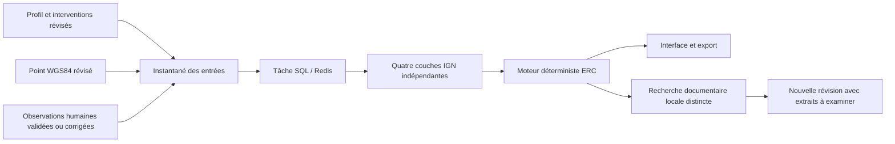

# Contexte territorial et aide à l’aménagement — MVP V2

Le dossier de parcelle possède une **Analyse préliminaire du projet**, indépendante de la génération scientifique. Un propriétaire peut enregistrer un point et des interventions, lancer IGN puis consulter les faits, les vérifications par intervention et l’export JSON. Le formulaire historique reste en lecture seule sur `/parcelles/:id`.

La couche [Adapter mon projet](PROJECT_DESIGN.md) ajoute douze alternatives concrètes pour les cinq interventions, avec effets sur le projet, conditions, références et niveaux de justification. Elle complète les vérifications et les propositions écologiques qualifiées décrites ci-dessous.

## Parcours et preuve

Les déclarations du projet, annotations humaines et résultats cartographiques sont trois catégories de preuve distinctes. Une déclaration enregistrée ne constitue pas un constat écologique. Un point ne constitue ni le contour parcellaire, ni l’emprise des travaux. Les prédictions automatiques sont exclues.

## Contrat HTTP

Toutes les routes exigent une session. Les écritures conservent les contrôles d’origine et CSRF existants. Le propriétaire du corpus et l’administrateur peuvent accéder au dossier ; un autre client reçoit `404`.

| Route | Requête / résultat |
|---|---|
| `PUT /parcels/corpora/{id}/profile` | Profil complet historique, ou `{interventions, expected_revision}` pour l’éditeur limité |
| `PUT /parcels/corpora/{id}/location` | `{latitude, longitude, provenance: "numeric" ou "map", expected_revision}` ; retourne la localisation enregistrée |
| `POST /parcels/corpora/{id}/territorial-queries` | `{expected_location_revision, expected_profile_revision}` ; `202`, `{id, status: "pending"}` |
| `GET /parcels/corpora/{id}/territorial-context` | État courant des entrées, dernière analyse, obsolescence et état documentaire indépendant |
| `GET /parcels/corpora/{id}/territorial-context?revision=N` | Analyse historique avec ses entrées originales |
| `GET /parcels/corpora/{id}/territorial-context/export?revision=N` | Instantané JSON complet, réponses archivées et toutes les justifications |

Les coordonnées sont finies et bornées : latitude `[-90,90]`, longitude `[-180,180]`. La consultation envoie un GeoJSON `Point` dans l’ordre **[longitude, latitude]**. Une localisation absente produit `422` ; une révision dépassée produit `409`. La saisie numérique offre une alternative clavier à la carte Leaflet, dont le fond est attribué à OpenStreetMap.

Les cinq codes d’intervention sont `earthworks`, `vegetation_removal`, `fencing`, `outdoor_lighting`, `soil_sealing`. Les précisions libres existantes conservent les autres descriptions du projet.

- Profil historique sans champ : ce champ reste absent.
- Champ omis d’une sauvegarde : conserve les choix déjà présents.
- `interventions: []` : efface explicitement les choix.
- `null` ou code inconnu : refusé.
- Aucun de ces états ne prouve l’absence de travaux.

L’éditeur limité peut créer un profil partiel contenant seulement les interventions. Le dossier scientifique historique exige un profil complet et valide **la révision demandée**, sans empêcher l’analyse territoriale.

## Persistance et tâches

La migration `0013_territorial_context` ajoute `parcel_locations` et `territorial_queries`, étend les types de tâches documentaires et ne réécrit aucun profil. Le retour de migration refuse de supprimer des localisations ou analyses déjà enregistrées.

Les sauvegardes et allocations de révision utilisent le verrou transactionnel existant. L’instantané comprend localisation, provenance, acteur et date, profil complet et sa révision, observations humaines et leurs révisions, couches et archives, empreinte des entrées, version des règles et révision d’analyse. Toute modification de ces entrées rend l’analyse ancienne obsolète, y compris une correction ou un retrait d’observation. L’ancienne analyse reste exportable.

Les tâches `territorial` ont la priorité interactive dans l’outbox et Redis, ainsi qu’aux points de reprise du worker documentaire. Les demandes identiques déjà en attente sont dédupliquées. Le worker reprend les tâches SQL orphelines et les livraisons Redis ; les couches déjà archivées sont réutilisées après interruption. Une consultation terminée n’est pas écrasée. Une relance explicite après achèvement crée une nouvelle consultation.

Le GET destiné au polling retire les corps bruts et les géométries volumineuses de sa projection. Ils restent conservés en SQL et présents dans l’export. Les propriétés, noms, identifiants, états et empreintes demeurent consultables.

## IGN

Le connecteur atteint uniquement les quatre endpoints HTTPS fixes de `apicarto.ign.fr/api/nature/` : `znieff1`, `znieff2`, `natura-habitat`, `natura-oiseaux`. Il ne suit aucune redirection et ne reçoit aucune URL fournie par l’utilisateur.

Chaque tentative est bornée à 15 secondes, avec deux tentatives maximum pour les indisponibilités transitoires, un budget réseau global de 120 secondes et une limite de 8 Mio décompressés par couche. Une réponse invalide, potentiellement tronquée ou trop grande reste une erreur explicite. Une réponse GeoJSON vide ne démontre pas l’absence de biodiversité.

| Par couche | Signification |
|---|---|
| `success` | Zonage(s) renvoyé(s) au point |
| `empty` | Réponse valide, aucun zonage renvoyé au point |
| `unavailable` | Service/réseau inaccessible, résultats inconnus |
| `error` | Réponse refusée, invalide ou inexploitable |

Le statut global est `pending`, puis `complete` si les quatre couches ont répondu valablement, `partial` si une partie seulement a répondu, `failed` sinon. L’échec d’une tâche est également visible. Les réponses conservées portent date, URL, statut HTTP, nombre de tentatives et empreinte SHA-256 du corps décompressé. Le statut IGN ne dépend pas du complément scientifique.

## Règles et cadre ERC

Les actions exposent `category`, `project_action`, `issue`, `action`, `rationale`, `evidence_refs`, `source_refs`, `preconditions`, `missing_information`, `limitations`, `evidence_status`. Les références sont vérifiées par le contrat Pydantic avant publication.

| Déclencheur | Résultat déterministe |
|---|---|
| Clôture déclarée + faune terrestre validée | Examiner conception/usages et déplacements effectifs ; aucun corridor affirmé |
| Clôture sans faune validée | Préciser tracé et usages ; vérifier les enjeux sur le terrain |
| Éclairage déclaré | Examiner nécessité, emplacement et horaires, puis documenter les sensibilités |
| Suppression de végétation déclarée | Inventorier les éléments réellement présents ; conservation à étudier si les enjeux sont établis |
| Terrassement/imperméabilisation + intersection | Examiner emprise et habitats réels ; aucun impact certain déduit du point |
| Interventions absentes ou liste vide | Questions sur les travaux, sans présumer leur absence |
| Aucune espèce validée | Faits territoriaux et questions conditionnelles ; prédictions écartées |

`investigate` désigne une **vérification générale**, transverse à ERC. `avoid` et `reduce` désignent exclusivement des **propositions conditionnelles**. Le moteur exige une source citée avec extrait, page, empreinte et examen explicite d’applicabilité avant de produire ces catégories ; une intersection ou une observation isolée ne peut pas suffire. Le contrat de sortie refuse une proposition ERC qui ne remplit pas cette condition.

Pour les propositions écologiques du champ `actions`, la recherche lexicale automatique ne réalise pas cet examen d’applicabilité : ses résultats restent des candidats. Aucun flux de revue scientifique d’applicabilité supplémentaire n’est créé dans ce MVP. En l’absence de cette qualification, les catégories Éviter/Réduire de ces actions affichent leur insuffisance documentaire et les vérifications restent À approfondir. Les alternatives de conception du nouveau champ `design_proposals` restent disponibles sous leurs niveaux exploratoire ou contextualisé ; elles ne sont pas des recommandations écologiques validées. Les tests de propositions conditionnelles utilisent des sources synthétiques explicitement examinées dans leurs fixtures ; ils ne prouvent aucune efficacité écologique réelle.

`compensation.status` vaut toujours `not_assessed`. La présentation suit **Éviter → Réduire → Compenser** ; « À approfondir » n’est pas une troisième étape ERC. Aucun score, pourcentage, reproduction, abondance, habitat précis ou obligation réglementaire n’est inféré.

## Complément scientifique facultatif

Le résultat déterministe est enregistré avant la programmation de `territorial_evidence`. Cette tâche réutilise la recherche RAG et ses filtres de corpus admissible : documents liés aux espèces confirmées, non exclus, texte disponible, références bibliographiques écartées. Elle ne télécharge aucun modèle, n’indexe aucun embedding et n’appelle aucun LLM.

Au maximum dix requêtes lexicales locales, quatre extraits chacune, sont effectuées pour les interventions enregistrées. Sans espèce validée, aucune recherche n’est lancée. Les candidats conservent texte, page, empreintes du fichier et du texte, provenance et motif de rapprochement. Une correspondance lexicale seule n’ajoute aucune mesure.

Des candidats trouvés créent une nouvelle révision déterministe, sans modifier la première. Un résultat documentaire tardif ne masque pas une consultation plus récente. Absence de source ou échec documentaire laisse les faits IGN disponibles. L’indisponibilité de programmation du complément est journalisée et ne fait pas échouer le résultat déterministe.

## Sources et périmètre

- [Contrat officiel IGN Nature](https://apicarto.ign.fr/api/doc/nature.yml), vérifié le 10 novembre 2026 : `geom`, WGS84 et couches.
- [Présentation officielle ERC](https://www.ecologie.gouv.fr/politiques-publiques/eviter-reduire-compenser-impacts-lenvironnement) : ordre des étapes et cadre méthodologique.
- [Documentation Leaflet 1.9.4](https://github.com/Leaflet/Leaflet/tree/v1.9.4) et [attribution OpenStreetMap](https://www.openstreetmap.org/copyright).
- [Recette, commandes et preuves](TERRITORIAL_VALIDATION.md).

GBIF, nouveaux jeux régionaux, comparaison d’implantations, scores et réécriture du rapport RAG sont reportés. Aucun déploiement ni fusion dans `main` n’est effectué.
