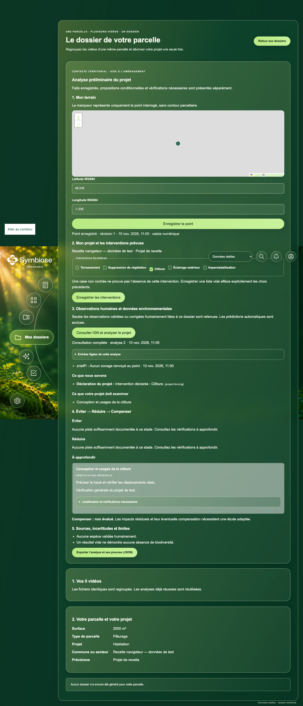

# Recette territoriale — 10 novembre 2026

Le parcours déterministe est testé avec sessions réelles, PostgreSQL, Redis et worker documentaire. Les consultations IGN de Caen et Carentan sont authentiques. Les observations animales utilisées dans les tests sont **synthétiques**. La base de développement locale ne possède aucun dossier ni observation humaine réelle : la recette vidéo de terrain n’a donc pas été effectuée.

## Résultats exécutés

| Vérification | Résultat |
|---|---|
| Première tranche : contrats, localisation, profils et sessions réelles | 6 tests réussis |
| Connecteur, consultations durables, export et reprise | 11 tests ciblés réussis |
| Scénarios ERC A/B, C, D, E, F | Réussis ; déclencheurs et preuves vérifiés |
| Suite CPU complète | 214 réussis, 11 ignorés, 102 désélectionnés au passage final |
| Intégrations documentaires + revue humaine, sans modèles facultatifs | 74 réussis, 4 ignorés, 27 désélectionnés avant le dernier test de concurrence documentaire |
| Intégrations territoriales + corpus historiques, après ce test | 15 réussis |
| Contrat ERC final + sessions réelles | 15 réussis (territoire et authentification) |
| Consultation IGN réelle via le worker | 1 test, deux points interrogés, huit réponses valides |
| Vitest | 78 tests réussis |
| TypeScript/Vite | Build réussi |
| Playwright : territoire, modes de données, authentification | 13 tests réussis ; contrôle Axe inclus dans le parcours territorial |
| Playwright territorial après les derniers ajustements visuels | 2 tests réussis |
| Ruff sur backend/shared/workers/tests/initialisation | Réussi |

Les tests d’autorisation territoriale désactivent expressément le remplacement historique par un administrateur. Ils créent des comptes et des sessions via les routes d’authentification, puis vérifient l’accès propriétaire, le refus d’un autre compte, CSRF et origine. Le test A/B complet traverse la file Redis réelle avec une observation synthétique validée, puis vérifie l’obsolescence après correction de sa révision.

A/B conserve terrain, observations et éclairage ; l’ajout de `fencing` ajoute les vérifications de clôture sans modifier celles de l’éclairage. C utilise quatre couches vides ; D des erreurs/indisponibilités ; E aucune espèce validée, y compris une prédiction exclue ; F du terrassement avec intersection sans conclusion d’impact certain. Des tests distincts couvrent sources absentes, hors sujet, non admissibles et indisponibles, révision documentaire nouvelle et immutabilité de la première analyse.

Les tests navigateur utilisent des réponses API de test. Leur capture ne prouve pas une consultation directe IGN ni une observation animale réelle. Le fond OSM y est volontairement bloqué pour rendre la recette reproductible ; la sélection du point et son alternative numérique restent testées.



## Preuves IGN authentiques

Archives compressées : [Caen](evidence/territorial/caen.json.gz), [Carentan](evidence/territorial/carentan.json.gz). Le [manifeste](evidence/territorial/manifest.json) fournit les dates, empreintes des archives, empreintes des corps et identifiants. Les archives contiennent les corps bruts ainsi que les objets normalisés ; elles portent `mode: archive` et l’origine « direct IGN via document worker ».

| Point WGS84 | Consultation du 10/11/2026, vers 11 h 36 Paris | Résultats |
|---|---|---|
| Caen, latitude `49.1829`, longitude `-0.3707` | Quatre réponses valides | Aucun zonage renvoyé par les quatre couches pour ce point |
| Carentan, latitude `49.316`, longitude `-1.235` | Quatre réponses valides | ZNIEFF1 vide ; ZNIEFF2 `250008148` ; Natura habitat `FR2500088` ; Natura oiseaux `FR2510046` |

Noms renvoyés à Carentan : « MARAIS DU COTENTIN ET DU BESSIN », « Marais du Cotentin et du Bessin - Baie des Veys », « Basses Vallées du Cotentin et Baie des Veys ». Ces réponses concernent exclusivement les coordonnées indiquées. Elles n’établissent ni présence d’habitat sur une emprise de travaux, ni conséquence réglementaire individuelle. Les coordonnées exactes d’une recette antérieure n’étaient pas présentes dans le dépôt : ce sont les points précisément utilisés pendant cette exécution.

Vérification hors réseau des archives :

```python
import gzip, hashlib, json
from pathlib import Path

root = Path("docs/evidence/territorial")
for entry in json.loads((root / "manifest.json").read_text()):
    blob = (root / entry["file"]).read_bytes()
    assert hashlib.sha256(blob).hexdigest() == entry["archive_sha256"]
    archive = json.loads(gzip.decompress(blob))
    for layer in archive["layers"].values():
        if "raw_response" in layer:
            assert hashlib.sha256(layer["raw_response"].encode()).hexdigest() == layer["sha256"]
```

## Procédure de démonstration A/B

1. Se connecter avec un propriétaire de corpus et choisir **Données réelles**. Ouvrir son dossier. Les données restent isolées du mode démonstration.
2. Enregistrer le point de Carentan ci-dessus. Le marqueur est un point, jamais une emprise.
3. Pour A, enregistrer uniquement l’éclairage, ou une liste vide explicitement enregistrée. Lancer la consultation et attendre le résultat du worker. Consulter les faits, limites et actions À approfondir. Exporter la révision A.
4. Pour B, conserver le point et les observations, ajouter la clôture puis enregistrer. L’analyse A devient obsolète. Relancer la consultation et exporter B. Comparer uniquement les actions justifiées par l’intervention ajoutée. Si une observation humaine de faune terrestre est disponible dans le corpus, sa référence doit figurer dans la vérification de déplacements ; sinon la formulation reste générale.
5. Ouvrir « Justification et vérifications nécessaires » : déclencheurs, sources, préconditions et informations manquantes. Éviter/Réduire restent sans proposition spécifique si l’applicabilité documentaire n’a pas été examinée. Compenser est non évalué.
6. Retrouver A par `territorial-context?revision=N` ou son export. Ses entrées originales sont conservées. Une correction d’observation ou un changement de point rend aussi cette analyse obsolète.
7. Passer en démonstration pendant une consultation : les résultats réels disparaissent et aucune requête territoriale n’utilise un identifiant fictif. Revenir en réel pour reprendre le suivi.

**Secours archive :** décompresser les fichiers de preuve et présenter leur manifeste comme **archives du 10/11/2026**. Ils ne sont jamais injectés comme repli du mode réel. Une panne IGN actuelle doit rester visible comme panne.

## Commandes réellement utilisées

Exécutées depuis la racine du dépôt, sauf les commandes npm depuis `frontend/`. Le préfixe local `rtk proxy` transmet les commandes sans en modifier la sémantique.

```sh
# Services de développement uniquement ; aucun volume réinitialisé.
docker compose up -d postgres redis
# Un override temporaire a exposé PostgreSQL/Redis sur 15483/16483, en boucle locale.
docker compose -f docker-compose.yml -f /private/tmp/symbiose-dev-ports.yml up -d postgres redis

docker compose --profile test build tests

docker run --rm --network biosentinelle_services \
  -v "$PWD:/app:ro" -e POSTGRES_HOST=photosynthese-postgres \
  biosentinelle-tests alembic -c backend/alembic.ini upgrade head

docker run --rm --network biosentinelle_services \
  -v "$PWD:/app:ro" -e POSTGRES_HOST=photosynthese-postgres \
  -e REDIS_URL=redis://photosynthese-redis:6379/0 \
  biosentinelle-tests pytest -q

docker run --rm --network biosentinelle_services \
  -v "$PWD:/app:ro" -e POSTGRES_HOST=photosynthese-postgres \
  -e REDIS_URL=redis://photosynthese-redis:6379/0 \
  biosentinelle-tests pytest tests/documents tests/test_review_integration.py \
  -m 'integration and not real_model and not gpu' -q

docker run --rm -v "$PWD:/app:ro" biosentinelle-tests \
  ruff check backend shared workers tests infra/init_storage.py

npm ci --cache /private/tmp/symbiose-npm-cache
npm run build
env NODE_OPTIONS=--no-experimental-webstorage npm test
env NODE_OPTIONS=--no-experimental-webstorage npx playwright test \
  tests/e2e/territorial.spec.ts tests/e2e/data-modes.spec.ts tests/e2e/authentication.spec.ts

git diff --check
```

La consultation réelle a utilisé un réseau de validation avec accès sortant, en plus du réseau interne des services :

```sh
docker network create symbiose-territorial-validation
docker run --rm --network biosentinelle_services --network symbiose-territorial-validation \
  -v "$PWD:/app:ro" -v "$PWD/docs/evidence/territorial:/evidence" \
  -e POSTGRES_HOST=photosynthese-postgres \
  -e REDIS_URL=redis://photosynthese-redis:6379/0 \
  -e TERRITORIAL_LIVE=1 -e TERRITORIAL_EVIDENCE_DIR=/evidence \
  biosentinelle-tests pytest tests/documents/test_territorial_live.py -m integration -q
```

Les comptes/corpus de cette recette live existaient uniquement dans un schéma SQL temporaire. Aucun identifiant de session ou de compte n’est archivé. La migration est contrôlée en base : `0013_territorial_context`, zéro corpus et zéro observation validée/corrigée dans le schéma de développement public.

## Corrections de recette et limites

- Le Python local 3.14 ne possède pas la roue binaire Psycopg verrouillée par ce dépôt. Les tests utilisent donc son image Python 3.12 prévue, sans modifier les dépendances Python.
- Le Node local 25 expose un `localStorage` incompatible avec les tests DOM ; l’option `--no-experimental-webstorage` permet la suite Vitest. Aucun contournement n’est ajouté à l’application.
- Un premier test d’intégration a nécessité l’application des migrations et de l’extension vector sur la nouvelle base locale. Un redémarrage Docker a interrompu une exécution ; elle a été relancée.
- Les anciens tests de génération remplaçaient une classe par une fonction, incompatible avec le constructeur actuel et son contrôle `isinstance`. Leur fixture est maintenant une classe avec session neutre. Deux sélecteurs navigateur d’authentification périmés et la fixture du nouveau GET territorial ont été actualisés. Deux lignes historiques trop longues ont été reformatées pour le lint complet.
- Les tests facultatifs demandant torch/sklearn ou des modèles réels ne sont pas validés ici. Aucun modèle n’a été téléchargé. Les autres API scientifiques externes restent en opt-in.
- `npm ci` a signalé huit vulnérabilités dans l’arbre existant (sept modérées et une élevée). Aucun changement de versions hors ajout Leaflet/types n’est inclus.
- Aucun dossier avec vidéo de terrain et observation réelle n’était disponible dans cette base locale. Le test A/B avec faune validée utilise une fixture synthétique ; les preuves IGN utilisent le service public réel.
- Les propositions spécifiques Éviter/Réduire nécessitent un examen d’applicabilité scientifique qui n’est pas automatisé par la recherche lexicale. Le parcours livré privilégie des vérifications justifiées, sans fabriquer cet appui.
- Aucun serveur applicatif n’est déployé ; aucune fusion dans `main`. La livraison Git est limitée à `feature/opendata`.

Fichiers principaux : migration `0013`, routes/permissions dans `backend/app`, contrats et règles dans `shared/parcels`, connecteur et deux tâches dans `workers/documents`, composants territoriaux et protection du mode réel dans `frontend`. Les détails du contrat sont dans [TERRITORIAL_CONTEXT.md](TERRITORIAL_CONTEXT.md).
