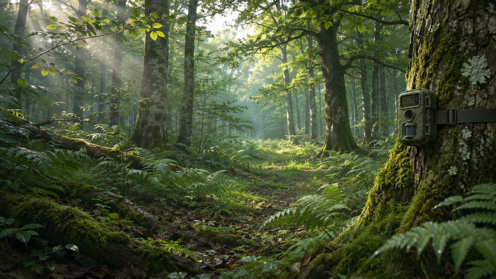
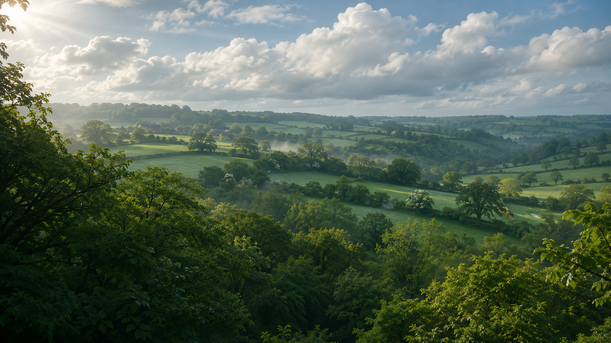
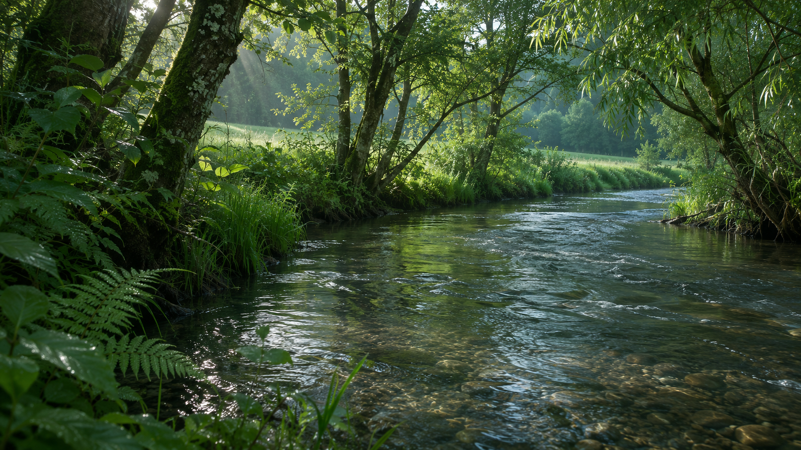
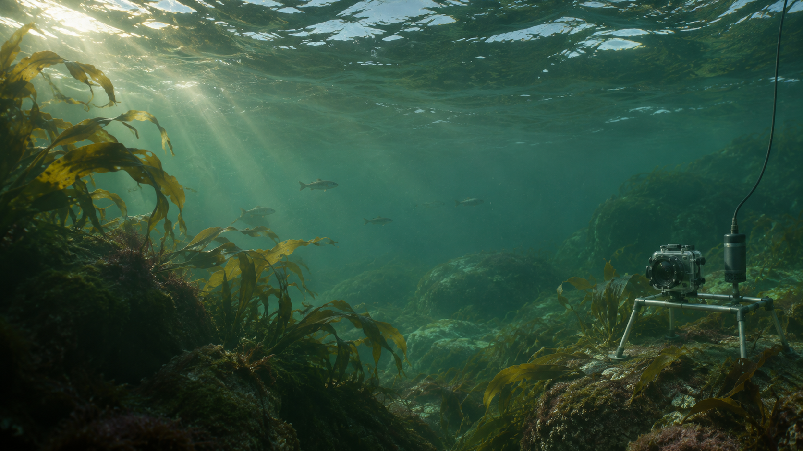
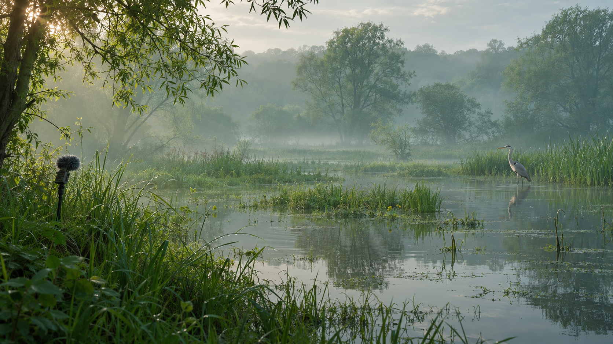
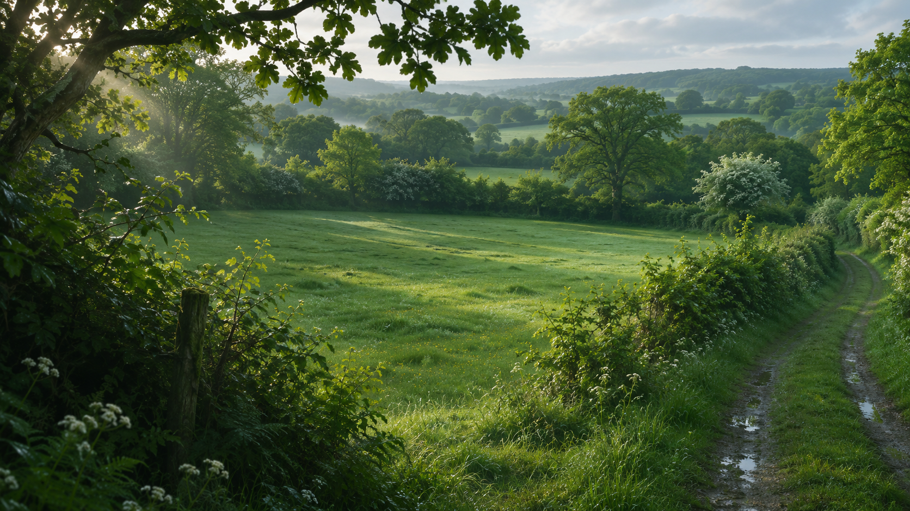
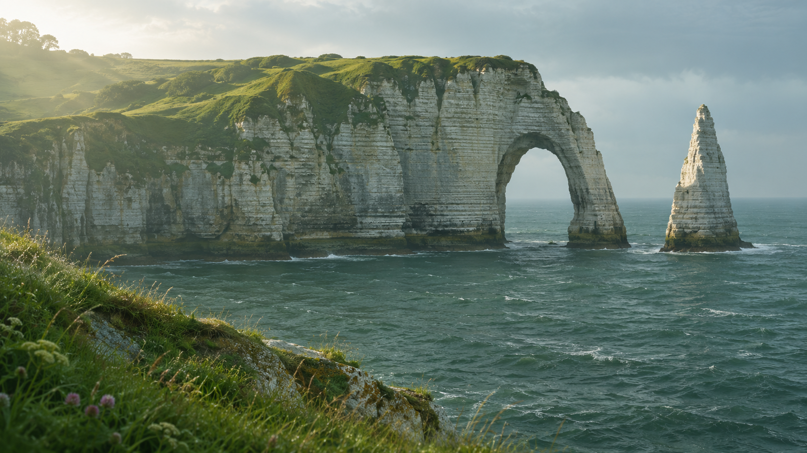
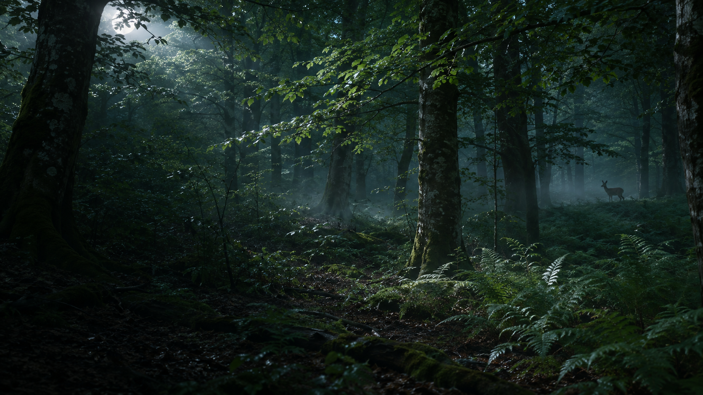

# Storyboard — huit atmosphères, cinq minutes

Ce storyboard reprend les durées de la planche validée. Il ne modifie pas les deux chapitres exécutables du prototype technique. Les images liées sont des évocations générées, jamais des observations documentaires. Les trajectoires et raccords ci-dessous sont des **consignes de production**, pas des animations livrées.

| Chapitre | Temps | Rôle dans l’oral |
| --- | --- | --- |
| 1. Forêt | 0:00–0:35 | L’éveil : partir du terrain et du problème |
| 2. Ciel et nuages | 0:35–1:00 | L’ambition : prendre de la hauteur |
| 3. Rivières | 1:00–1:35 | Les données : lire les connexions du territoire |
| 4. Monde sous-marin | 1:35–1:55 | La vision : envisager l’observation aquatique |
| 5. Zone humide | 1:55–2:30 | La technologie : observer, proposer, faire vérifier |
| 6. Prairie et bocage | 2:30–4:00 | La démonstration : 90 secondes dans le produit réel |
| 7. Littoral — Étretat | 4:00–4:25 | Les impacts : replacer le projet dans un territoire |
| 8. Forêt nocturne | 4:25–5:00 | La conclusion : l’humain en symbiose avec la nature |

La séquence bocage de 90 secondes est destinée à accueillir la vidéo produit : elle n’est pas une visite de 90 secondes d’un paysage figé. Aucun clip de démonstration n’est livré. La rivière et la Manche illustrent des milieux différents : leur rapprochement constitue une ellipse narrative, pas une continuité hydrographique affirmée.

## 01 — Forêt · 0:00–0:35

**Image générée par IA.** Évocation artistique d’un milieu normand, sans localisation authentifiée ni preuve d’observation.

| Élément de production | Direction |
| --- | --- |
| 1. Plan principal | Passage forestier et tronc porteur de la caméra piège. |
| 2. Premier plan | Fougères humides et mousse proches, en bordure basse, détourées séparément. |
| 3. Arrière-plan | Hêtres et chênes moins contrastés ; trouée vers la canopée dans le tiers haut. |
| 4. Profondeur | Troncs échelonnés à 2, 7 et 20 m ; conserver le couloir central libre. |
| 5. Atmosphère | Brume basse gris vert, rayons discontinus dans la trouée ; aucune particule lumineuse magique. |
| 6. Éléments animés envisagés | Micro-mouvement des frondes par vent faible ; poussières éclairées rares. |
| 7. Palette | #073322 · #365934 · #5b8539 · #c8d58d · #f5f8ef |
| 8. Trajectoire et focale | Travelling avant à 0,45 m, puis inclinaison progressive et élévation vers la trouée, 28→32 mm. |
| 9. Entrée / sortie | Entrée : Fougères à hauteur du regard, axe de passage visible. Sortie : Trouée de canopée identifiée dans le tiers haut. |
| 10. Ressources de raccord | Canopée 3D et clean plates en continuité ; géométrie/occlusion, pas un zoom sur cette image. |

[Master généré](../../frontend/public/experience-art/forest/primary-v1.png) · [Premier plan candidat](../../frontend/public/experience-art/forest/foreground-v1.png) · [Manifest de scène](../../frontend/public/experience-art/forest/manifest.json) · [Prompts des ressources manquantes](../../frontend/public/experience-art/forest/prompts/missing.json)

## 02 — Ciel et nuages · 0:35–1:00

**Image générée par IA.** Évocation artistique d’un milieu normand, sans localisation authentifiée ni preuve d’observation.

| Élément de production | Direction |
| --- | --- |
| 1. Plan principal | Révélation du bocage depuis la canopée. |
| 2. Premier plan | Extrémités de cimes feuillues, sans tronc opaque au centre. |
| 3. Arrière-plan | Bocage vallonné, ciel et cumulus en plans séparés. |
| 4. Profondeur | Cimes proches, haies médianes, collines brumeuses et nuages lointains. |
| 5. Atmosphère | Brume de vallée et lumière diffuse des cumulus, hautes lumières ivoire. |
| 6. Éléments animés envisagés | Dérive lente des nuages ; feuillage proche très discret. |
| 7. Palette | #173f35 · #678447 · #8fa3a5 · #d3d9c5 · #f5f8ef |
| 8. Trajectoire et focale | Sortie à 45 m, léger recul et inclinaison vers une vallée ; 32 mm. |
| 9. Entrée / sortie | Entrée : Cimes correspondant au plan de sortie de la forêt. Sortie : Vallée et méandre placés vers le tiers droit. |
| 10. Ressources de raccord | Cimes détourées, ciel prolongé et géométrie du terrain ; raccord vers une vallée à pré-rendre ultérieurement. |

[Master généré](../../frontend/public/experience-art/sky/primary-v1.png) · [Premier plan candidat](../../frontend/public/experience-art/sky/foreground-v1.png) · [Manifest de scène](../../frontend/public/experience-art/sky/manifest.json) · [Prompts des ressources manquantes](../../frontend/public/experience-art/sky/prompts/missing.json)

## 03 — Rivières · 1:00–1:35

**Image générée par IA.** Évocation artistique d’un milieu normand, sans localisation authentifiée ni preuve d’observation.

| Élément de production | Direction |
| --- | --- |
| 1. Plan principal | Lit de rivière et courant guidant l’axe de lecture. |
| 2. Premier plan | Feuilles d’aulne, rameaux de saule et berge humide en bordure. |
| 3. Arrière-plan | Ripisylve et prairie de vallée, sans montagne. |
| 4. Profondeur | Feuilles à 0,8 m, reflets au milieu, courbe de berge à 30 m. |
| 5. Atmosphère | Vapeur très légère au ras de l’eau ; reflets non surexposés. |
| 6. Éléments animés envisagés | Reflets et rides à pré-rendre ; feuilles sous vent faible. |
| 7. Palette | #153d32 · #47714d · #5d8174 · #a7b8a0 · #e4e7d1 |
| 8. Trajectoire et focale | Travelling suivant le courant à 0,7 m puis descente vers un reflet, 35 mm. |
| 9. Entrée / sortie | Entrée : Axe du méandre révélé au chapitre ciel. Sortie : Reflet de surface agrandi, sans coupe dans une berge. |
| 10. Ressources de raccord | Passe de surface, clean plate sous le reflet, séquence pré-rendue ; passage rivière→Manche à assumer comme ellipse de milieux. |

[Master généré](../../frontend/public/experience-art/rivers/primary-v1.png) · [Premier plan candidat](../../frontend/public/experience-art/rivers/foreground-v1.png) · [Manifest de scène](../../frontend/public/experience-art/rivers/manifest.json) · [Prompts des ressources manquantes](../../frontend/public/experience-art/rivers/prompts/missing.json)

## 04 — Monde sous-marin · 1:35–1:55

**Image générée par IA.** Évocation artistique d’un milieu normand, sans localisation authentifiée ni preuve d’observation.

| Élément de production | Direction |
| --- | --- |
| 1. Plan principal | Colonne d’eau marine et silhouettes discrètes de faune tempérée. |
| 2. Premier plan | Laminaires brun vert au bord inférieur, rocher discret. |
| 3. Arrière-plan | Eau vert gris et surface filtrant la lumière. |
| 4. Profondeur | Frondes proches, capteurs sur la droite, poissons médians et silhouettes lointaines atténuées. |
| 5. Atmosphère | Absorption verte progressive, matières en suspension rares, visibilité modérée. |
| 6. Éléments animés envisagés | Frondes et caustiques lentes ; poissons en silhouette, sans comportement affirmé. |
| 7. Palette | #0a3038 · #24534f · #56796b · #9fb9a4 · #d9e5d3 |
| 8. Trajectoire et focale | Franchissement de surface puis travelling immergé stable à 3 m, 24 mm. |
| 9. Entrée / sortie | Entrée : Surface d’eau au-dessus du cadre, raccord lumineux upper-left. Sortie : Remontée vers des tiges rétroéclairées qui annoncent les roseaux. |
| 10. Ressources de raccord | Séquence de franchissement à pré-rendre, profondeur et occlusions de surface ; pas de prétendue continuité hydrographique rivière→Manche. |

[Master généré](../../frontend/public/experience-art/underwater/primary-v1.png) · [Premier plan candidat](../../frontend/public/experience-art/underwater/foreground-v1.png) · [Manifest de scène](../../frontend/public/experience-art/underwater/manifest.json) · [Prompts des ressources manquantes](../../frontend/public/experience-art/underwater/prompts/missing.json)

Les dispositifs acoustiques et aquatiques sont illustratifs et relèvent d’une évolution envisagée. Aucun traitement acoustique ou modèle de classification marine fonctionnel n’est revendiqué.

## 05 — Zone humide · 1:55–2:30

**Image générée par IA.** Évocation artistique d’un milieu normand, sans localisation authentifiée ni preuve d’observation.

| Élément de production | Direction |
| --- | --- |
| 1. Plan principal | Chenal de marais, roseaux et héron dans les hauts-fonds. |
| 2. Premier plan | Roseaux avec bords fins et tiges détourables. |
| 3. Arrière-plan | Prairies inondables et saules dissous dans la brume. |
| 4. Profondeur | Roseaux proches, plan d’eau médian, silhouettes de saules lointaines. |
| 5. Atmosphère | Brume matinale crème verte en trois nappes à faible contraste. |
| 6. Éléments animés envisagés | Roseaux souples, petites rides, oiseaux à distance ; acoustique illustrée seulement. |
| 7. Palette | #243f32 · #6a7755 · #9c9f78 · #c2c4a5 · #f0ead6 |
| 8. Trajectoire et focale | Travelling latéral très lent à 1,2 m, regard puis élévation vers la prairie, 50→35 mm. |
| 9. Entrée / sortie | Entrée : Tiges rétroéclairées dans l’axe de la remontée d’eau. Sortie : Haie lisible derrière les roseaux, ligne de prairie au-dessus de la brume. |
| 10. Ressources de raccord | Roseaux détourés, matte de brume et clean plate de prairie ; séquence de remontée à prévoir. |

[Master généré](../../frontend/public/experience-art/wetland/primary-v1.png) · [Premier plan candidat](../../frontend/public/experience-art/wetland/foreground-v1.png) · [Manifest de scène](../../frontend/public/experience-art/wetland/manifest.json) · [Prompts des ressources manquantes](../../frontend/public/experience-art/wetland/prompts/missing.json)

Les dispositifs acoustiques et aquatiques sont illustratifs et relèvent d’une évolution envisagée. Aucun traitement acoustique ou modèle de classification marine fonctionnel n’est revendiqué.

## 06 — Prairie et bocage · 2:30–4:00

**Image générée par IA.** Évocation artistique d’un milieu normand, sans localisation authentifiée ni preuve d’observation.

| Élément de production | Direction |
| --- | --- |
| 1. Plan principal | Mosaïque de prairies et réseau continu de haies. |
| 2. Premier plan | Haie proche, branches et herbes de prairie en bordure. |
| 3. Arrière-plan | Collines bocagères douces et brume de vallée. |
| 4. Profondeur | Haie proche, parcelle médiane et lisières lointaines. |
| 5. Atmosphère | Lumière encore matinale, verts tempérés ; contraste décroissant avec la distance. |
| 6. Éléments animés envisagés | Herbes et feuillage léger ; survol stable ; vidéo réelle du produit à fournir. |
| 7. Palette | #173f35 · #4c743c · #7c984c · #b9c78a · #f5f8ef |
| 8. Trajectoire et focale | Survol progressif à 25→45 m, stabilisation sur une prairie ; 35 mm. |
| 9. Entrée / sortie | Entrée : Haie commune au fond du marais. Sortie : Vue stable servant de raccord d’intention vers la démo réelle. |
| 10. Ressources de raccord | Vidéo produit 90 s + affiche + sous-titres + captures autorisées ; raccord à l’application réelle non développé. |

[Master généré](../../frontend/public/experience-art/meadow/primary-v1.png) · [Premier plan candidat](../../frontend/public/experience-art/meadow/foreground-v1.png) · [Manifest de scène](../../frontend/public/experience-art/meadow/manifest.json) · [Prompts des ressources manquantes](../../frontend/public/experience-art/meadow/prompts/missing.json)

## 07 — Littoral — Étretat · 4:00–4:25

**Image générée par IA.** Évocation reconnaissable d’Étretat ; l’arche et l’Aiguille sont distinctes. Ce n’est pas une photographie documentaire ou un relevé géométrique.

| Élément de production | Direction |
| --- | --- |
| 1. Plan principal | Porte d’Aval et Aiguille distinctes dans un paysage de côte d’Albâtre. |
| 2. Premier plan | Pelouse littorale et détails de craie au bord bas, sans masquer les repères. |
| 3. Arrière-plan | Manche gris vert, falaise stratifiée et horizon marin voilé. |
| 4. Profondeur | Herbes proches, surface marine médiane, arche et aiguille séparées, côte lointaine. |
| 5. Atmosphère | Lumière naturelle ivoire, craie non brûlée, brume marine discrète. |
| 6. Éléments animés envisagés | Houle basse, eau et herbes ; aucun effet touristique ou drone visible. |
| 7. Palette | #183c3a · #496967 · #6b8278 · #d0d4bf · #f3efdc |
| 8. Trajectoire et focale | Travelling latéral de côte gardant arche et aiguille dans le cadre, 50 mm. |
| 9. Entrée / sortie | Entrée : Horizon de prairie devenant plateau de craie. Sortie : Bord ombré du plateau ou silhouette de falaise, raccord de valeur vers la nuit. |
| 10. Ressources de raccord | Géométrie ou reconstruction multi-vues validée d’Étretat, eau et clean plates ; pas de déformation de l’arche pour créer de la parallaxe. |

[Master généré](../../frontend/public/experience-art/coast/primary-v1.png) · [Premier plan candidat](../../frontend/public/experience-art/coast/foreground-v1.png) · [Manifest de scène](../../frontend/public/experience-art/coast/manifest.json) · [Prompts des ressources manquantes](../../frontend/public/experience-art/coast/prompts/missing.json)

## 08 — Forêt nocturne · 4:25–5:00

**Image générée par IA.** Évocation artistique d’un milieu normand, sans localisation authentifiée ni preuve d’observation.

| Élément de production | Direction |
| --- | --- |
| 1. Plan principal | Retour au passage forestier, présence animale distante et discrète. |
| 2. Premier plan | Mêmes familles de fougères et de troncs que le début. |
| 3. Arrière-plan | Feuillus nocturnes et trouée lunaire modeste. |
| 4. Profondeur | Frondes, troncs médians et silhouette animale dans la brume, jamais plaquée sur le texte. |
| 5. Atmosphère | Clair de lune sobre, bleu vert contenu, brume basse ; pas de lucioles inventées. |
| 6. Éléments animés envisagés | Brume très lente et mouvements minimes ; silhouette sobre sans fausse observation. |
| 7. Palette | #071e21 · #163b38 · #31544a · #879d8c · #dfdfcf |
| 8. Trajectoire et focale | Travelling ralenti à 1 m puis arrêt sur l’espace de conclusion, 35 mm. |
| 9. Entrée / sortie | Entrée : Raccord de valeur depuis l’ombre du littoral ; ellipse temporelle assumée. Sortie : Cadre immobile et ouverture lisible pour la conclusion Symbiose. |
| 10. Ressources de raccord | Fougères nocturnes et brume séparées, correspondance géométrique forêt initiale ; aucun raccord animé produit à ce stade. |

[Master généré](../../frontend/public/experience-art/night-forest/primary-v1.png) · [Premier plan candidat](../../frontend/public/experience-art/night-forest/foreground-v1.png) · [Manifest de scène](../../frontend/public/experience-art/night-forest/manifest.json) · [Prompts des ressources manquantes](../../frontend/public/experience-art/night-forest/prompts/missing.json)

## Point de contrôle avant les raccords

Les huit masters et les calques candidats servent à la validation de l’univers. Il reste à reconstruire les fonds masqués, calibrer les profondeurs, valider les géométries et produire les séquences et la vidéo réelle. Aucune transition supplémentaire n’est engagée. La revue doit confirmer que les huit vues appartiennent au même film, que les milieux tempérés sont crédibles et que le duo arche/Aiguille est lisible sans légende touristique.

